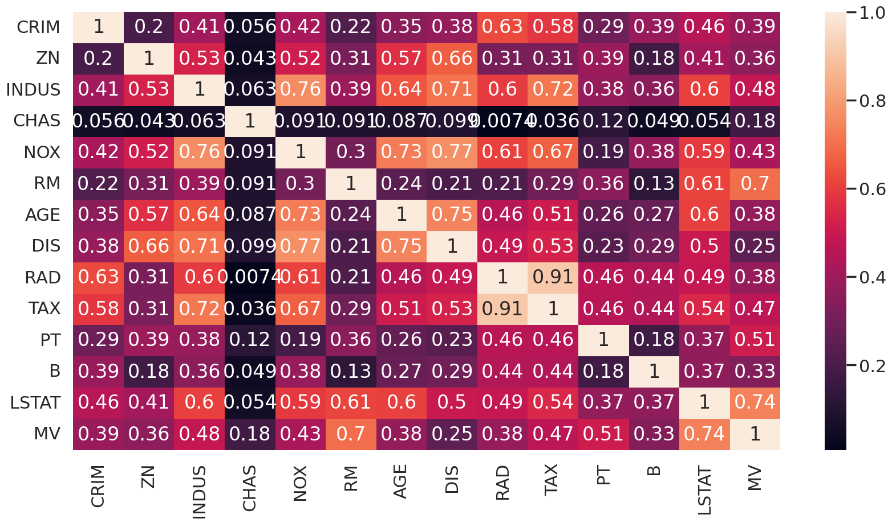
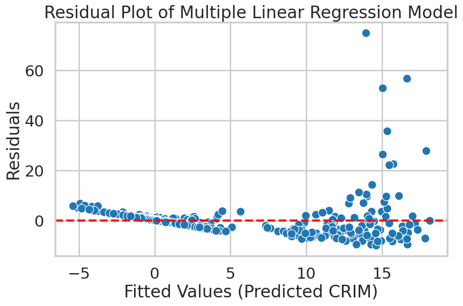
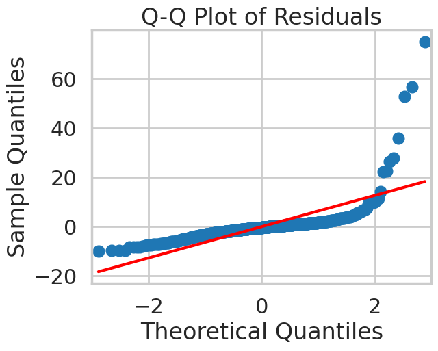

# What Predicts Crime Rate? Regression Analysis on the Boston Housing Dataset

> 🎓 Completed as part of the **Higher Diploma in Science in Data Analytics (QQI Level 8)** at **Dublin Business School**, 2025–2026 (graduated with First Class Honours).
*Module: Statistics for Data Analytics (CA1).*

## Problem
Using the classic Boston Housing dataset, model the **per-capita crime rate (CRIM)** from the other 13 neighbourhood variables, and compare simple, multiple and polynomial regression.

## Data
`data/boston.csv`, the public Boston Housing dataset (506 census tracts).

## Tools
Python (pandas, NumPy, statsmodels, scikit-learn, SciPy, matplotlib, seaborn)

## Method
1. Descriptive statistics, histograms, boxplots and a correlation heatmap
2. A **simple linear regression** of CRIM on each predictor
3. A **multiple linear regression** (OLS) on all predictors, with hypothesis tests for each coefficient
4. A comparison of simple vs multiple regression coefficients
5. **Polynomial (cubic) fits** to look for non-linear relationships
6. Residual diagnostics (residuals vs fitted, histogram, Q–Q plot)

## Key results
- Every predictor except **CHAS** (Charles River dummy) had a significant simple-regression relationship with CRIM (p < 0.001). CHAS: R² = 0.003, p = 0.209.
- Strongest single predictors: **RAD** (highway access, R² = 0.391) and **TAX** (R² = 0.340).
- In the multiple regression, the null hypothesis was rejected for **MV, ZN, DIS, RAD and B** (p < 0.05), plus LSTAT at the 0.10 level.
- NOX and DIS showed clear **non-linear** relationships with CRIM.





## How to run
```bash
pip install -r requirements.txt
cd notebooks && jupyter notebook boston_housing_regression.ipynb   # reads ../data/boston.csv
```

## Author
Jean Ly Kon · [LinkedIn](https://www.linkedin.com/in/jeankly) · [GitHub](https://github.com/jennykonjl)
